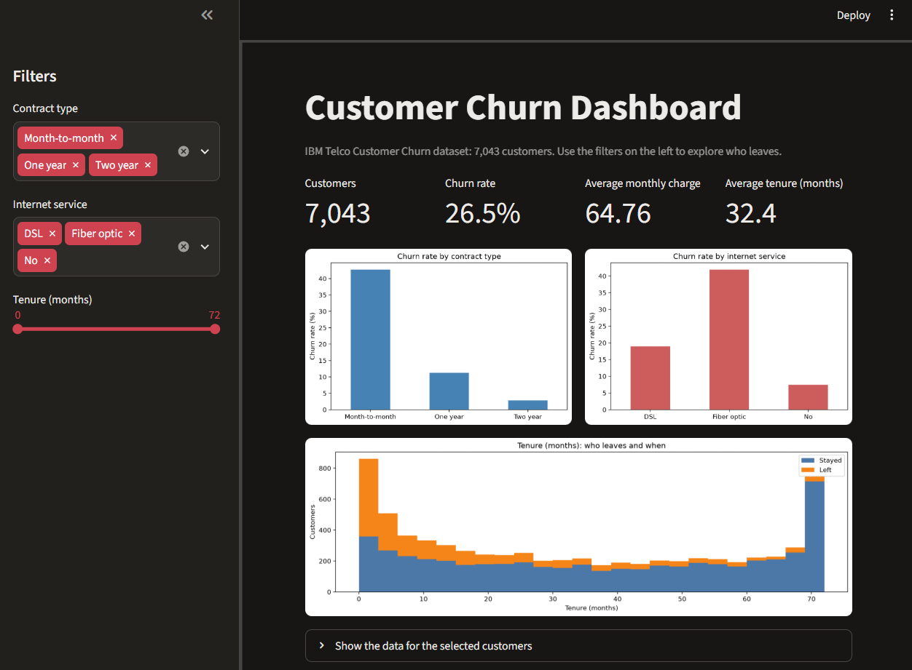

# Customer Churn Dashboard

An interactive dashboard for exploring which telecom customers leave, built with Python and Streamlit.

## What it does
The sidebar filters customers by contract type, internet service and tenure (months with the company). Every time a filter changes, the key numbers and charts update:
- number of customers, churn rate, average monthly charge and average tenure
- churn rate by contract type
- churn rate by internet service
- tenure histogram, split into customers who stayed and customers who left
- a table of the selected customers

## Example
Selecting only month-to-month contracts shows 3,875 customers with a churn rate of 42.7% and an average tenure of 18 months, much higher churn than the full customer base (26.5%).

## Data
IBM's public Telco Customer Churn dataset: 7,043 customers. Source: https://github.com/IBM/telco-customer-churn-on-icp4d

The analysis behind this dashboard (cleaning, modelling, results) is in my [Customer Churn Prediction](../churn-prediction) project.

## How to run
1. Install the libraries: pip install -r requirements.txt
2. Start the app: python -m streamlit run app.py
3. Open http://localhost:8501 in your browser

## Files
- app.py: the dashboard code
- telco-churn.csv: the dataset
- requirements.txt: the libraries needed
- dashboard.png: screenshot

## Tools
Python, Streamlit, pandas, matplotlib