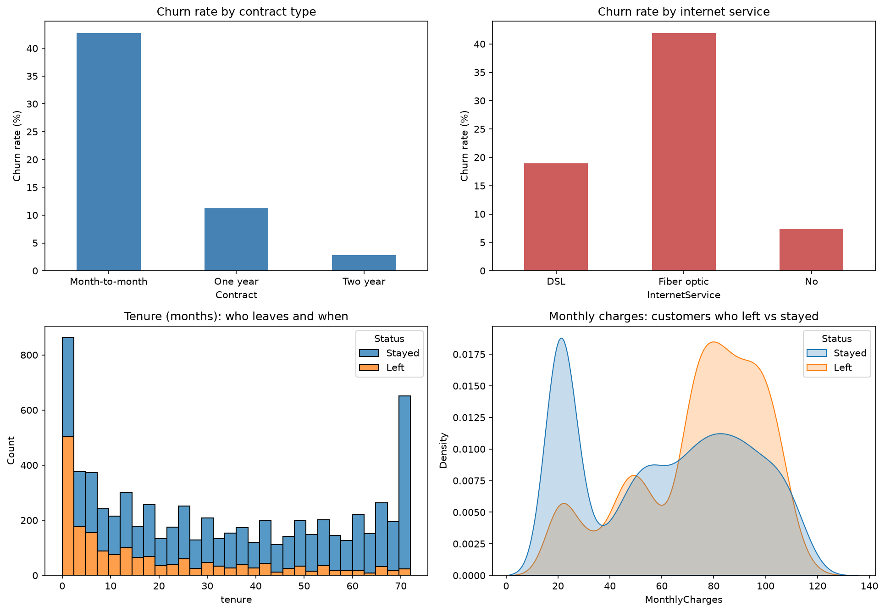
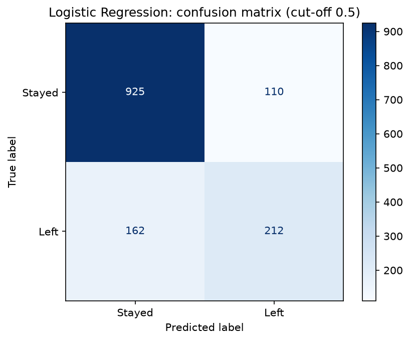
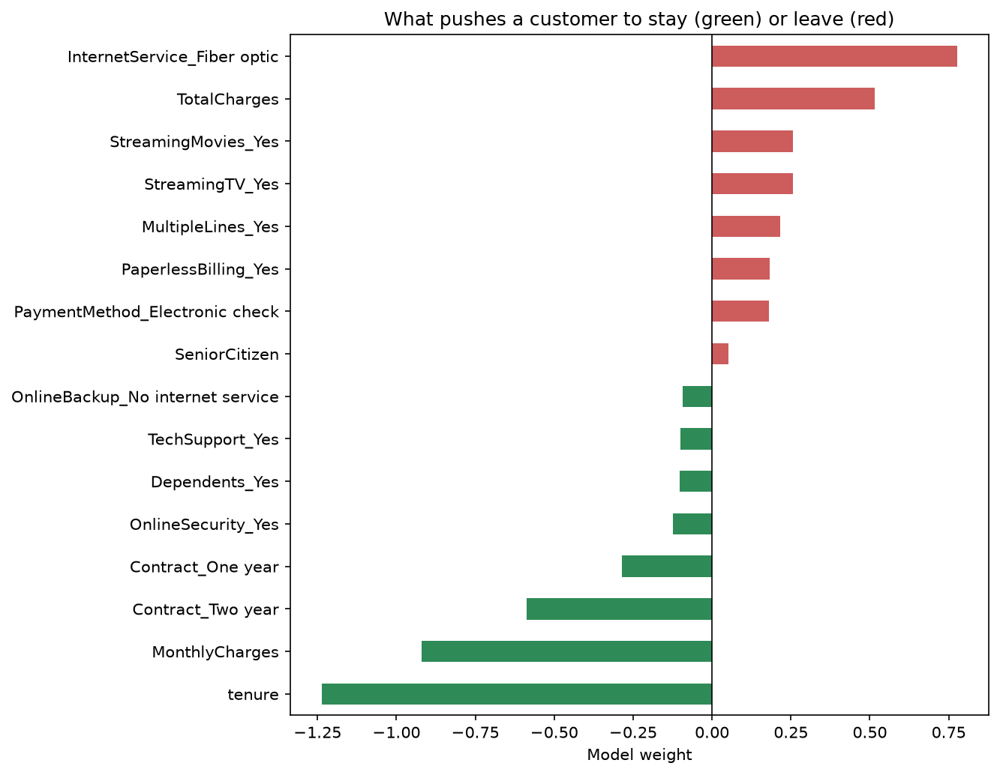

# Customer Churn Prediction

Predicting which telecom customers are likely to leave, and finding out why, using Python, scikit-learn and XGBoost.

## The problem
A telecom company loses customers every month, and keeping a customer is usually cheaper than winning a new one. This project asks two questions: which customers are likely to leave, and what do they have in common?

## Data
IBM's public Telco Customer Churn dataset: 7,043 customers and 20 features covering demographics, services, contract type and billing. About 26.5% of customers churned. Source: https://github.com/IBM/telco-customer-churn-on-icp4d

## What I did
1. Cleaned the data. 11 blank TotalCharges values belonged to brand-new customers (tenure 0) who had not been billed yet, so I set them to 0. I removed customerID so the model could not memorise individuals.
2. Explored the data with charts to see what separates customers who leave from those who stay.
3. Split the data 80/20 into training and test sets, keeping the churn share equal in both.
4. Trained Logistic Regression and XGBoost and compared them on the unseen test customers.
5. Looked at the model's mistakes and tested different decision cut-offs.

## Key findings
- Month-to-month contracts have the highest churn (about 42%, against about 11% for one-year and 3% for two-year contracts).
- Fiber optic customers churn at about 42%, against 19% for DSL and 7% for customers with no internet.
- Many customers who leave do so in their first few months, and customers who leave tend to have higher monthly bills.

## Model results
The baseline of always predicting "stayed" scores 73.5% accuracy.

| Model | Accuracy | Precision | Recall | F1 | ROC-AUC |
|---|---|---|---|---|---|
| Logistic Regression | 0.807 | 0.658 | 0.567 | 0.609 | 0.842 |
| XGBoost | 0.800 | 0.656 | 0.516 | 0.578 | 0.846 |

Both models beat the baseline by about 7 points. XGBoost did not beat the simpler Logistic Regression model, so I used Logistic Regression for the rest of the analysis because it is easier to explain.

At the default 0.5 cut-off the model catches 212 of the 374 customers who left (recall 0.567) and misses 162.

## Choosing a cut-off
Lowering the cut-off catches more leavers but flags more customers who would have stayed:

| Cut-off | Precision | Recall | Customers flagged (of 1,409) |
|---|---|---|---|
| 0.50 | 0.658 | 0.567 | 322 |
| 0.40 | 0.567 | 0.668 | 441 |
| 0.30 | 0.519 | 0.754 | 543 |
| 0.25 | 0.498 | 0.810 | 608 |

I would use 0.30: it catches about three in four leavers while flagging around 38% of customers. The right cut-off depends on the cost of a retention offer compared with the cost of losing a customer.

## What drives churn

Short tenure, month-to-month contracts and fiber optic service push customers towards leaving. Tenure, monthly charges and total charges overlap, so I did not read their individual weights as separate causes.

## Limitations
- One dataset and one train/test split, so results could shift on different data.
- I did not tune the models, so XGBoost might improve with tuning.
- The model finds patterns, not causes. A retention offer would need testing before drawing conclusions.

## Files
- churn-analysis.ipynb: the full analysis
- telco-churn.csv: the dataset
- images: charts used in this README

## How to run
Install the libraries with: pip install pandas numpy matplotlib seaborn scikit-learn xgboost
Then open churn-analysis.ipynb in Jupyter and run all cells.

## Tools
Python, pandas, scikit-learn, XGBoost, matplotlib, seaborn