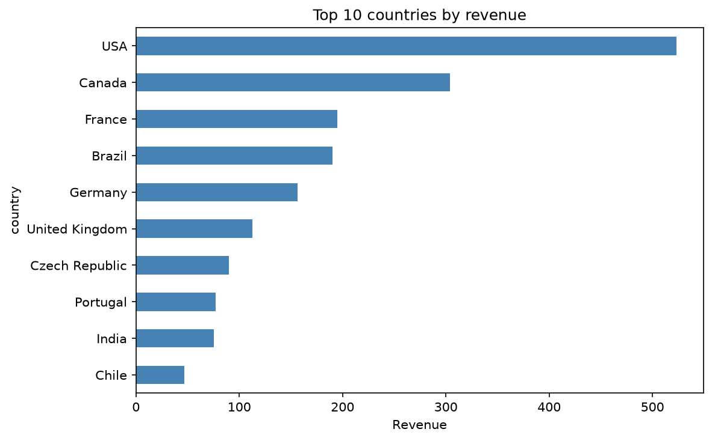
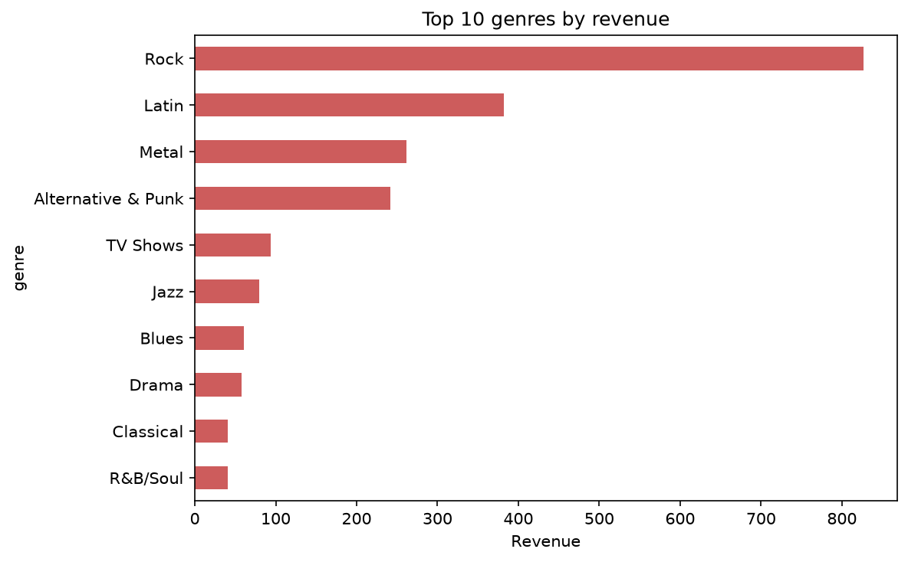
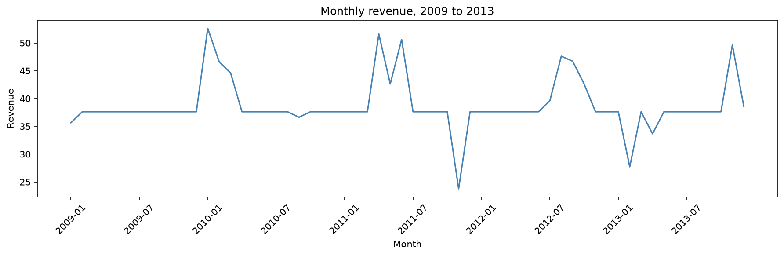

# SQL Sales Analysis

Answering business questions about a digital music store with SQL, using Python, SQLite and Jupyter.

## The problem
A store wants to know where its revenue comes from. Which years, countries, customers, genres and artists matter most, and is there any trend over time?

## Data
The Chinook sample database: 11 tables, 59 customers, 412 invoices and 2,240 invoice lines for a digital media store (music and TV shows), covering 2009 to 2013. Source: https://github.com/lerocha/chinook-database

Important: the sales records in Chinook are randomly generated, so this project is practice in SQL analysis, not a set of real business insights.

## What I did
1. Explored the tables and how they link together (Customer, Invoice, InvoiceLine, Track, Album, Artist, Genre).
2. Wrote SQL queries using GROUP BY, ORDER BY, date functions and multi-table JOINs.
3. Followed up on a surprising result instead of stopping at the first answer (see Key findings).
4. Turned the query results into charts with matplotlib.

## Key findings
- Yearly revenue is steady, between 449 and 481 each year, with 80 to 83 invoices per year.
- The USA brings in the most revenue (523.06), then Canada (303.96) and France (195.10).
- The USA leads because it has the most customers (13), not because they spend more. Revenue per customer is about 38 to 40 in most countries. Chile and the Czech Republic show higher figures, but they have only 1 or 2 customers, so those numbers are not reliable.
- The top customer is Helena Holý (Czech Republic) with 49.62 over 7 purchases. All of the top five customers made exactly 7 purchases.
- Rock is the best-selling genre by a wide margin (826.65 revenue, 835 tracks sold), followed by Latin, Metal and Alternative & Punk.
- The top artists are Iron Maiden (138.60), U2 (105.93) and Metallica (90.09). The TV show Lost appears in the top five, because the store sells video as well as music.
- Monthly revenue sits at about 37.6 for most of the five years, with occasional spikes and dips (highest 52.62 in January 2010, lowest 23.76 in November 2011). Real data would rarely be this flat, which fits the data being generated.

## SQL skills shown
SELECT, WHERE-style filtering with LIMIT, GROUP BY, ORDER BY, COUNT, SUM and COUNT(DISTINCT), date functions with strftime, INNER JOINs across up to four tables, and calculated columns.

## Limitations
- The data is randomly generated, so patterns such as the flat monthly revenue should not be read as real customer behaviour.
- With only 59 customers, country-level averages for small countries are based on one or two people.
- This is descriptive analysis only. It does not explain why customers buy or predict future sales.

## Files
- sql-sales-analysis.ipynb: the full analysis with all SQL queries
- chinook.db: the SQLite database
- images: charts used in this README

## How to run
Install the libraries with: pip install pandas matplotlib
Then open sql-sales-analysis.ipynb in Jupyter and run all cells. SQLite is built into Python.

## Tools
Python, SQL (SQLite), pandas, matplotlib, Jupyter